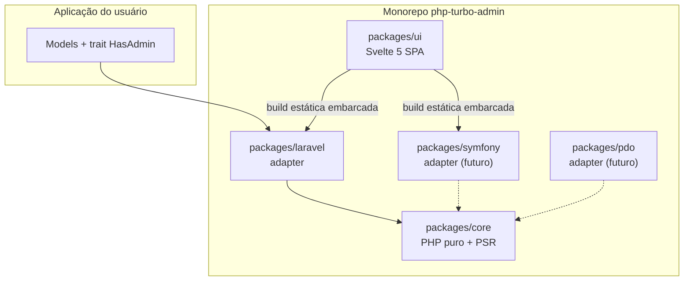
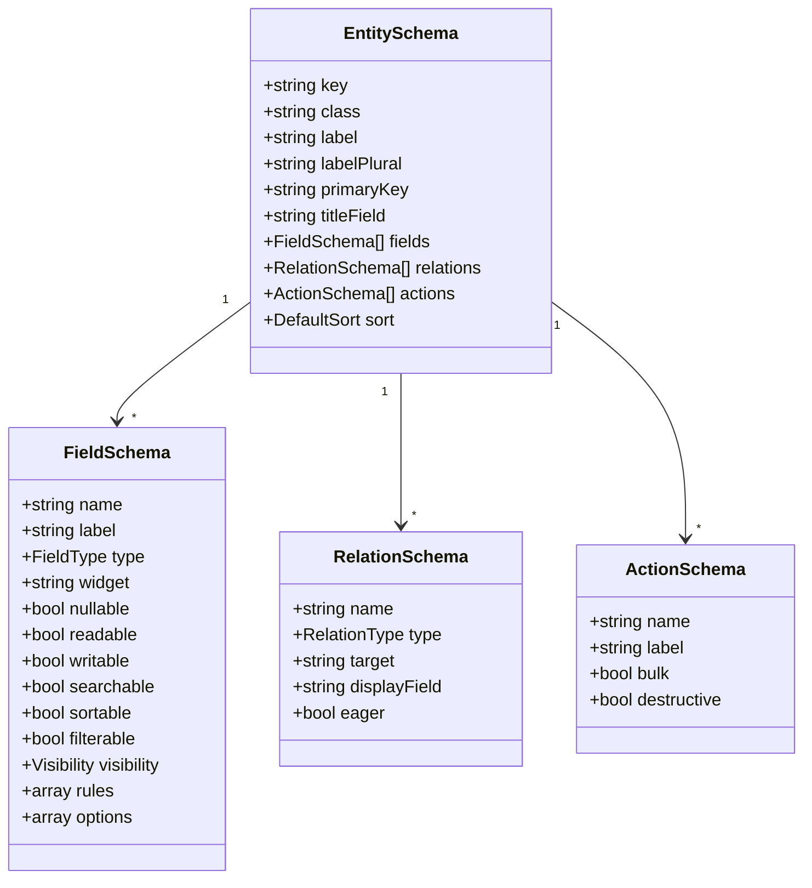
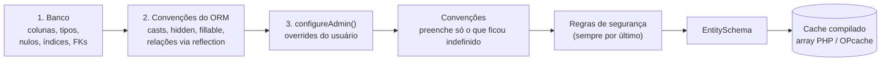
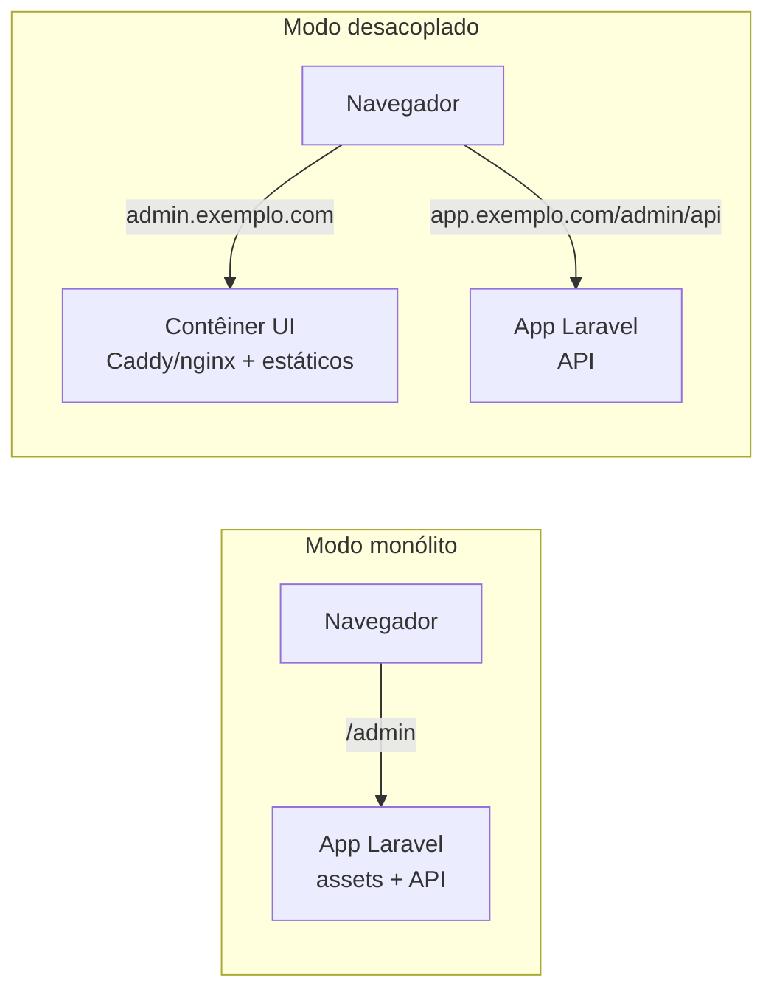

# php-turbo-admin — Arquitetura

> Status: **v0.1 em desenvolvimento** · 2026-10-01 · core, adapter Laravel (metadados + API) e SPA implementados
> Painel admin open source, gratuito (MIT), gerado a partir dos models da aplicação, com core agnóstico de framework.

## 1. Visão geral

O php-turbo-admin gera um painel administrativo completo (listagem, busca, filtros, CRUD, relações) a partir dos models existentes, com **configuração zero por padrão** e overrides opcionais declarados no próprio model.

Diferencial em relação às alternativas:

| | Laravel Nova | Filament | EasyAdmin | **php-turbo-admin** |
|---|---|---|---|---|
| Licença | Paga | MIT | MIT | MIT |
| Onde vive a configuração | Classe Resource | Classe Resource | Classe CrudController | **No model (opcional)** |
| Sem configuração | Não | Não | Não | **Sim** |
| Front desacoplável (headless) | Não | Não (Livewire) | Não (Twig) | **Sim** |
| Multi-framework | Não | Não | Não | **Sim (core agnóstico)** |

### Pilares

1. **Segurança** — negar por padrão; nunca contornar regras de negócio da aplicação.
2. **Performance** — nenhuma introspecção em tempo de requisição; build de front pequena; queries enxutas.
3. **Manutenibilidade** — para quem implementa (core isolado, contratos testados) e para quem usa (`composer require` e funciona, sem Node).

### Não-objetivos (v1)

- Ser um framework ou construtor de aplicações genéricas.
- Page builder / dashboards arbitrários.
- Acesso direto ao banco contornando o ORM (exceto no adapter `pdo`, explicitamente marcado como tal).

## 2. Visão de componentes



### Pacotes

| Pacote | Conteúdo | Dependências permitidas |
|---|---|---|
| `core` | `EntitySchema`, merge de camadas, kernel HTTP da API, validação de query e de escrita, serialização, regras de segurança | nenhuma (PHP puro) |
| `laravel` | Trait `HasAdmin`, providers de metadados Eloquent, DataSource, Authorizer (Gate), ServiceProvider, comandos artisan | `core`, `illuminate/*` |
| `symfony` (futuro) | Bundle, provider de `ClassMetadata` Doctrine, Voters | `core`, `symfony/*`, `doctrine/orm` |
| `pdo` (futuro) | Introspecção via `information_schema`, sem regras de negócio | `core` |
| `ui` | SPA Svelte 5 + Vite, renderizador genérico dirigido pelo schema | dev-only (não é dependência em runtime do PHP) |

**Regra inegociável:** `core` não importa `Illuminate\*`, `Symfony\*` nem `Doctrine\*`. Verificado no CI (ver §11).

### Por que adapters, se o core é PHP puro

As regras de negócio da aplicação vivem no framework, não no banco. Falar direto com o banco ignoraria:

- **Global scopes** (multi-tenant, `SoftDeletes`) → vazamento de dados entre tenants.
- **Policies/Gate** → sistema de permissão duplicado.
- **Sessão/usuário autenticado** → login separado.
- **Casts, accessors, mutators** (incluindo `encrypted`) → dados crus ou gravados sem criptografia.
- **Events/Observers** → auditoria, cache, Scout e webhooks param de funcionar.
- **`$hidden`/`$fillable`** → regras de segurança perdidas.

Cache (PSR-16) e container (PSR-11) não exigem adapter. O adapter cobre só: metadados, persistência, autorização e registro (rotas, comandos, assets).

## 3. Core

### 3.1 EntitySchema

Objeto neutro, imutável e serializável que descreve uma entidade para o admin. É o único formato que o core e a UI conhecem.



- `FieldType` (semântico): `string`, `text`, `integer`, `decimal`, `money`, `boolean`, `date`, `datetime`, `time`, `enum`, `json`, `uuid`, `email`, `url`, `password`, `file`.
- `RelationType`: `belongsTo`, `hasOne`, `hasMany`, `belongsToMany`, `morphTo`, `morphMany`.
- `Visibility`: flags `index`, `detail`, `create`, `update`.
- `readable`/`writable` são decididos pelo core a partir das regras de segurança (§9) — nunca pelo cliente.

### 3.2 Portas

O core define as interfaces; cada adapter as implementa. Assinaturas completas em `packages/core/src`.

| Porta | Responsabilidade | Laravel |
|---|---|---|
| `Discovery\ModelDiscovery` | Quais classes entram no admin | `DirectoryModelDiscovery` (trait `HasAdmin`) |
| `Metadata\MetadataProvider` | Uma camada de metadados | `EloquentDatabaseProvider`, `EloquentModelProvider` |
| `Data\DataSource` | `list`, `find`, `create`, `update`, `delete`, `lookup` | `EloquentDataSource` |
| `Auth\Authorizer` | `can(actor, Ability, entity, ?record)` — deve negar sem regra | `GateAuthorizer` (Policies) |
| `Validation\RuleValidator` | Regras do framework (`->rules([...])`) | `LaravelRuleValidator` |

O `DataSource` recebe um `QueryPlan` calculado pelo core: só as colunas da tela e as relações exibidas (com o campo de título do alvo). O adapter nunca decide o que expor.

Contrato público para os models (framework-neutro):

```php
namespace PhpTurbo\Admin\Core;

interface AdminConfigurable
{
    public static function configureAdmin(AdminSchema $schema): void;
}
```

### 3.3 Responsabilidades do core

- Merge das camadas de metadados → `EntitySchema`.
- Compilação e leitura do cache de schemas.
- Aplicação das regras de segurança por padrão (§9).
- Filtragem do schema por usuário (via `Authorizer`).
- Validação de `ListQuery` (ordenação, filtros, busca, paginação) contra o schema.
- Kernel HTTP da API (`Http\ApiKernel`): roteamento, autorização em toda rota, validação, serialização e Problem Details (§6).

## 4. Resolução de metadados em camadas



- Cada camada é um `MetadataProvider` (`Priority::DATABASE` 100, `ORM` 200, `USER` 300); a seguinte sobrescreve a anterior. Providers extras entram por prioridade.
- As **convenções** não são uma camada: rodam depois de todas e só preenchem valores que nenhuma camada decidiu (`null`). Assim, nunca sobrescrevem uma escolha explícita e também cobrem relações declaradas pelo usuário.
- As regras de segurança rodam **depois** dos overrides para que um erro de configuração não exponha campos sensíveis sem opt-in explícito (`->allowSensitive()`).

### 4.1 O que cada camada resolve (Laravel)

| Informação | Fonte |
|---|---|
| Colunas, tipos, nulabilidade, índices | `Schema::getColumns()`, `getIndexes()` |
| Tipo semântico (enum, json, money, datas) | `$casts` / `casts()` |
| Campos ocultos | `$hidden` |
| Campos graváveis | `$fillable` / `$guarded` |
| Relações | Reflection em métodos públicos com tipo de retorno de relação (`: BelongsTo`, `: HasMany`, …) |
| `belongsTo` sem método declarado | FK do banco (quando existir) — apenas sugestão do `turbo-admin:doctor` (futuro), nunca auto-escrita |
| Labels, widgets, visibilidade, busca, ações | `configureAdmin()` |

Relações sem tipo de retorno declarado não são descobertas — devem ser declaradas em `configureAdmin()` com `relation('nome', RelationType::..., Alvo::class)`.

Métodos **sem** tipo de retorno de relação nunca são executados. Os que declaram o tipo são invocados numa instância vazia do model para obter alvo e chave estrangeira; construir uma relação não consulta o banco (coberto por teste). Métodos estáticos, com parâmetros obrigatórios, que lançam exceção, que retornam `null` ou relações sem equivalente no core são ignorados. Métodos vindos de traits do framework (ex.: `Notifiable::notifications`) ficam de fora.

Valores padrão aplicados pelas convenções:

| Item | Padrão |
|---|---|
| Ordenável | Chave primária ou coluna **líder** de algum índice (ordenar coluna sem índice custa caro) |
| Filtrável | `boolean` e `enum` |
| Buscável | Nenhum (opt-in) |
| Listagem | Tudo, exceto `text`/`json` |
| Coluna de FK de `belongsTo`/`morphTo` | Oculta das telas (a relação a representa) |
| Título | Primeiro entre `name`, `title`, `label`, `subject`, `email`; senão a PK |
| Ordenação | PK decrescente |

## 5. Integração com o model

### 5.1 Trait

```php
use PhpTurbo\Admin\Laravel\HasAdmin;

class Post extends Model
{
    use HasAdmin;

    // Opcional — só quando a inferência não bastar
    public static function configureAdmin(AdminSchema $schema): void
    {
        $schema->label('Publicações')
            ->field('title')->searchable()->sortable()
            ->field('body')->widget('richtext')->hideOnIndex()
            ->relation('author')->display('name')
            ->exclude('internal_notes');
    }
}
```

- `HasAdmin` implementa `AdminConfigurable` com `configureAdmin()` vazio (no-op) e marca o model para descoberta.
- Um único ponto de extensão, estático: evita poluir o namespace do model e colisões de nomes.
- `field()` e `relation()` só configuram o que já foi descoberto: um nome inexistente gera erro com a lista de nomes válidos, nunca um campo criado silenciosamente.

### 5.2 Models de vendor

Estender a classe original e adicionar o trait:

```php
namespace App\Models;

use Spatie\Permission\Models\Role as BaseRole;
use PhpTurbo\Admin\Laravel\HasAdmin;

class Role extends BaseRole
{
    use HasAdmin;
}
```

A documentação de uso deve destacar:

1. **Configure o pacote para usar a subclasse**, quando ele permitir (ex.: `config/permission.php` → `models.role`). Caso contrário, relações continuam retornando a classe base.
2. **Relações polimórficas:** a subclasse altera `getMorphClass()`. Se o pacote grava `*_type` no banco, use `Relation::enforceMorphMap()` para manter o valor estável.
3. O comando `turbo-admin:doctor` (futuro) detecta subclasses de vendor sem morph map e emite aviso.

## 6. Contrato da API

Base: `/{prefix}/api/v1` (prefixo padrão: `admin`). JSON, versionado na URL. Implementada uma única vez no core (`ApiKernel`); o adapter só converte a requisição do framework em `ApiRequest` (método, caminho, query, corpo, usuário) e a `ApiResponse` de volta.

| Método | Rota | Descrição | Autorização |
|---|---|---|---|
| `GET` | `/schema` | Entidades **visíveis ao usuário atual** | `viewAny` por entidade |
| `GET` | `/entities/{key}` | Listagem paginada | `viewAny` |
| `GET` | `/entities/{key}/lookup?q=` | Autocomplete para relações (até 20) | `viewAny` |
| `GET` | `/entities/{key}/{id}` | Detalhe | `view` no registro |
| `POST` | `/entities/{key}` | Criação | `create` |
| `PATCH` | `/entities/{key}/{id}` | Atualização parcial | `update` no registro |
| `DELETE` | `/entities/{key}/{id}` | Exclusão | `delete` no registro |
| `POST` | `/entities/{key}/actions/{action}` | Ação (futuro, 0.2) | — |
| `GET` | `/entities/{key}/{id}/relations/{relation}` | Itens relacionados (futuro, 0.2) | — |

Entidade inexistente e entidade sem `viewAny` respondem igual (**404**), sem revelar o que existe. Ações negadas em entidade visível: **403**.

Registro serializado:

```json
{
  "id": 7,
  "title": "Primeiro post",
  "attributes": { "id": 7, "title": "Primeiro post", "status": "published", "created_at": "2026-10-01T10:00:00-03:00" },
  "relations": { "author": { "id": 1, "title": "Ana" } },
  "abilities": { "update": true, "delete": false }
}
```

- `attributes` traz só campos legíveis; datas em ISO 8601, decimais como string, enums pelo valor.
- `relations` só inclui relações cujo alvo o usuário pode ver; o título usa um campo **legível** do alvo.
- `abilities` vem por registro (Policies), para a UI mostrar só os botões permitidos.

### 6.1 Listagem

```
GET /admin/api/v1/entities/posts?sort=-title&filter[status]=published&filter[user_id]=3&q=laravel&limit=25&cursor=...
```

- `sort`, `filter[*]` e `q` são validados contra `sortable`/`filterable`/`searchable`. Campo desconhecido → `400`; valor inválido em filtro → `422`. `filter[campo]=null` filtra `IS NULL` em campos anuláveis.
- **Cursor (keyset)** quando a ordenação é pela PK ou por coluna não anulável (com a PK como desempate). Coluna anulável → paginação por `page`. O cursor é `base64url(JSON)` opaco, validado ao decodificar.
- Sem `COUNT(*)`: busca `limit + 1` para saber se há próxima página.
- `limit` padrão 25, máximo 100 (configurável).
- Busca: `LIKE` sem diferenciar maiúsculas (`ILIKE` no PostgreSQL), com `%`/`_` escapados (o SQLite não tem caractere de escape padrão).

```json
{ "data": [ ... ], "meta": { "pagination": "cursor", "limit": 25, "page": null, "hasMore": true, "nextCursor": "WzQsNF0", "sort": { "field": "id", "direction": "desc" } } }
```

### 6.2 Exemplo de schema

```json
{
  "version": 1,
  "entities": [
    {
      "key": "posts",
      "label": "Publicações",
      "primaryKey": "id",
      "titleField": "title",
      "sort": { "field": "created_at", "direction": "desc" },
      "fields": [
        { "name": "id", "type": "integer", "readable": true, "writable": false,
          "visibility": ["index", "detail"] },
        { "name": "title", "type": "string", "nullable": false, "readable": true, "writable": true,
          "required": true, "searchable": true, "sortable": true,
          "visibility": ["index", "detail", "create", "update"] },
        { "name": "status", "type": "enum", "filterable": true,
          "options": [{ "value": "draft", "label": "Rascunho" }, { "value": "published", "label": "Publicado" }] }
      ],
      "relations": [
        { "name": "author", "label": "Autor", "type": "belongsTo", "target": "users", "foreignKey": "user_id", "writable": true }
      ],
      "actions": [],
      "searchable": true,
      "abilities": { "create": true }
    }
  ]
}
```

`abilities` é calculado por usuário. A UI apenas reflete; o backend revalida em toda requisição. O schema público **não inclui** classes PHP nem as regras de validação do framework (podem citar nomes de tabelas).

### 6.3 Erros

Formato [RFC 9457 (Problem Details)](https://www.rfc-editor.org/rfc/rfc9457):

```json
{ "type": "validation", "title": "Dados inválidos", "status": 422,
  "errors": { "status": ["Opção inválida."], "slug": ["The slug has already been taken."] } }
```

| Status | `type` | Quando |
|---|---|---|
| 400 | `bad_request` | Parâmetro de listagem inválido |
| 401 | `unauthenticated` | Sem sessão (middleware do adapter) |
| 403 | `forbidden` | Policy negou / Gate `viewAdmin` negou |
| 404 | `not_found` | Rota, entidade invisível ou registro inexistente |
| 405 | `method_not_allowed` | Método não suportado na rota |
| 409 | `conflict` | Violação de unicidade/integridade no banco (sem expor SQL) |
| 419 | — | Token CSRF inválido (middleware `web` do Laravel) |
| 422 | `validation` | Validação estrutural do core **e** regras do framework, na mesma resposta |

### 6.4 Escrita

1. **Core (estrutural):** só campos graváveis; obrigatórios na criação; tipo, nulabilidade e opções de enum; URLs só `http(s)`. Campo desconhecido ou não gravável é erro explícito, nunca ignorado.
2. **Adapter (regras):** `->rules([...])` com o Validator do Laravel, mais `exists` automático na FK de cada `belongsTo`. `{id}` nas regras vira a chave do registro em edição (`unique:posts,slug,{id}`).
3. **Persistência:** `fill()` + `save()` dentro de `transaction()` — observers e eventos rodam, e no PostgreSQL uma violação não aborta uma transação externa (usa savepoint).

## 7. UI

- **Svelte 5 + Vite**, SPA estática, sem SvelteKit/SSR. ~28 KB gzip (JS + CSS), com orçamento verificado no build (JS ≤ 45 KB, CSS ≤ 8 KB).
- **Renderizador genérico:** não conhece entidades; monta listagem, detalhe e formulários a partir de `/schema`. A build é idêntica para todos os usuários.
- **Distribuída pré-compilada** em `packages/laravel/dist` — o usuário final **não precisa de Node**. O `UiController` serve o `index.html` (com `<base href>` e CSP) e os assets com cache imutável.
- **Roteamento por hash** (`#/posts/7/edit`): funciona sob qualquer prefixo e em contêiner na raiz, sem rota catch-all no servidor.
- **Config em runtime:** `GET config.json` (URL da API, nome do app, usuário, logout). Nada é embutido na build.
- **Formulários:** `belongsTo` gravável vira seletor com busca (`lookup`); edição envia só o que mudou; erros 422 aparecem por campo.
- **CSS próprio** com design tokens em custom properties, tema claro/escuro por `prefers-color-scheme`, responsivo.
- **Tipos** em `src/lib/types.ts`, espelhando o contrato do core (gerar de OpenAPI fica para depois).
- **Extensibilidade (futuro):** widgets customizados como Web Components registrados por nome (`widget: 'x-map-picker'`), sem exigir rebuild da UI.

Desenvolvimento: `make ui-dev` sobe o Vite em `:5173` com proxy para a API do playground (os cookies de `localhost` valem em qualquer porta, então o login do playground funciona).

## 8. Modos de implantação

A mesma build de UI e a mesma API servem os dois modos. A API **sempre** roda dentro da aplicação, onde estão os models e as regras.



| | Monólito | Desacoplado |
|---|---|---|
| Servir UI | Rotas do pacote (`/admin`, `/admin/assets/*`) a partir de `dist/` ✅ | Imagem `php-turbo-admin-ui` (estáticos + Caddy) — 0.3 |
| Origem | Mesma origem | Mesmo *site*, subdomínios diferentes |
| Autenticação | Sessão da aplicação + CSRF | Sessão (cookie `SameSite`, domínio compartilhado) + CSRF + CORS com allowlist |
| Config | `config.json` gerado pelo pacote ✅ | `config.json` montado no contêiner; `turbo-admin.api_url` libera a origem da API na CSP ✅ |

## 9. Segurança

### 9.1 Negar por padrão

| Regra | Comportamento |
|---|---|
| Campos em `$hidden` (ou fora de `$visible`) | Nunca legíveis |
| Nomes sensíveis (`password`, `remember_token`, `*_token`, `*_secret`, `*_key`, `two_factor_*`) | Não legíveis; opt-in explícito com `->allowSensitive()` |
| Escrita | Apenas campos `$fillable` (ou fora de `$guarded`) **e** `writable` no schema |
| Chave primária, timestamps, `deleted_at` | Somente leitura |
| Campo sem leitura **e** sem escrita | Omitido do schema (não revela que a coluna existe) |
| Busca, ordenação e filtro | Só em campos legíveis (evita inferir valores ocultos) |
| Visibilidade | Telas de leitura exigem campo legível; formulários exigem campo gravável |
| Entidades | Só aparecem se o `Authorizer` permitir `viewAny` |
| Ações | Cada ação passa pelo `Authorizer` (Policy/Gate) |

### 9.2 Autorização

- Laravel: Policies/Gate. Abilities: `viewAny`, `view`, `create`, `update`, `delete`, `action:{name}`.
- Sem Policy registrada para o model → **acesso negado** (configurável para modo dev, com aviso em `turbo-admin:doctor`).
- Gate global de acesso ao painel (`viewAdmin`), obrigatório.

### 9.3 Entrada

- `sort`/`filter`/`q`/`include` validados contra o schema; nomes de coluna nunca são interpolados a partir da requisição.
- Validação de escrita com regras do schema + regras declaradas pelo usuário.
- Toda persistência passa pelo ORM (scopes, casts, events preservados).

### 9.4 Front

- CSP estrita: sem scripts inline, sem `eval`. Config via `config.json`.
- `{@html}` proibido por lint.
- Tokens nunca em `localStorage`; autenticação por cookie `HttpOnly`.
- CSRF pelo header `X-XSRF-TOKEN` (cookie do Laravel); logout é `POST`, nunca link `GET`.
- Links só para `http(s)`/`mailto`; valores são sempre texto (teste automatizado proíbe `{@html}`, `innerHTML` e `eval` no código da UI).
- Assets servidos com `realpath` + checagem de prefixo (sem path traversal) e lista fechada de tipos MIME.

### 9.5 Cadeia de suprimentos

- Dependências mínimas; lockfiles versionados; Dependabot.
- SBOM e assinatura/provenance nas releases.
- Política de divulgação em `SECURITY.md`.

## 10. Performance

- **Sem introspecção em runtime de produção:** `turbo-admin:cache` compila todos os `EntitySchema` em um arquivo PHP com array puro (OPcache). Escrita atômica (arquivo temporário + `rename`). Sem o arquivo (dev), o registro é compilado sob demanda. Invalidação automática por `mtime` fica para uma versão futura.
- **Queries:** `SELECT` apenas das colunas visíveis no índice; eager loading das relações marcadas `eager`; paginação keyset; `COUNT(*)` opcional (desligado por padrão em tabelas grandes).
- **Schema filtrado por usuário** calculado uma vez por requisição e cacheável por papel.
- **UI:** build pequena, code-splitting por rota, assets com hash + cache imutável.

## 11. Manutenibilidade

### 11.1 Repositório

```
php-turbo-admin/
├── packages/
│   ├── core/
│   ├── laravel/
│   ├── symfony/      (futuro)
│   ├── pdo/          (futuro)
│   └── ui/
├── docs/
└── .github/workflows/
```

- Monorepo com split para repositórios somente leitura (`splitsh-lite`) publicados no Packagist.
- PHP mínimo: **8.2**. Laravel: **12+** (o 11 já está sem suporte).
- Desenvolvimento local: Sail no `playground/` (app Laravel real), que monta `packages/` e roda os testes dos pacotes contra SQLite, MySQL 8.4 e PostgreSQL 18. Comandos em `Makefile`.

### 11.2 Qualidade (CI)

| Verificação | Ferramenta |
|---|---|
| Fronteira do core (sem `Illuminate`/`Symfony`/`Doctrine`) | PHPStan com vendor isolado do core: qualquer classe de framework vira erro |
| Análise estática | PHPStan (nível máximo no core) |
| Estilo | PHP-CS-Fixer / Pint |
| Testes unitários do core | PHPUnit / Pest |
| Testes de integração do adapter | Orchestra Testbench (matriz Laravel 12/13 × PHP 8.2–8.5 × SQLite/MySQL/PostgreSQL) |
| Cobertura mínima | 95% por pacote (`pest --coverage --min=95`), falha o CI abaixo disso |
| Contrato da API | Validação das respostas contra `openapi.yaml` |
| UI | `svelte-check` sem avisos, Vitest + Testing Library (mínimo 90% de linhas), orçamento de tamanho |
| E2E | Playwright contra o playground: navegação, filtros, CRUD, seletor de relação, logout — falha em qualquer erro de console (inclui violações de CSP) |

### 11.3 Versionamento

- SemVer. API HTTP versionada separadamente (`/v1`); quebra de contrato → `/v2` com período de convivência.
- Changelog no formato *Keep a Changelog*.

### 11.4 Comandos (adapter Laravel)

| Comando | Função |
|---|---|
| `turbo-admin:cache` / `turbo-admin:clear` | Compila / remove cache de schemas ✅ |
| `turbo-admin:schema {entity?}` | Lista as entidades ou mostra o `EntitySchema` resolvido em JSON ✅ (origem de cada valor por camada: futuro) |
| `turbo-admin:install` | Publica config, registra Gate `viewAdmin`, publica assets |
| `turbo-admin:doctor` | Audita: models sem Policy, campos sensíveis expostos, subclasses de vendor sem morph map, relações sem tipo de retorno |

Prefixo `turbo-admin:` para não colidir com comandos `admin:` de outros pacotes. Config publicada em `config/turbo-admin.php`.

## 12. Roadmap

| Fase | Entrega |
|---|---|
| **0.1** | ✅ Core (schema, camadas, convenções, segurança, cache, API) · ✅ adapter Laravel (introspecção, convenções Eloquent, descoberta, comandos, DataSource, Policies, rotas) · ✅ UI (listagem, detalhe, CRUD, seletor de relação) · ✅ modo monólito |
| **0.2** | Relações (belongsTo, hasMany, belongsToMany), lookup, filtros, busca, ações em lote, `turbo-admin:doctor` |
| **0.3** | Modo desacoplado (imagem de contêiner), tema, i18n (pt-BR, en) |
| **0.4** | Uploads de arquivo, widgets via Web Components |
| **1.0** | Contrato v1 estável, documentação completa |
| **Pós-1.0** | Adapter Symfony (Doctrine), adapter PDO |

## 13. Decisões registradas

| # | Decisão | Alternativas descartadas | Motivo |
|---|---|---|---|
| D1 | Configuração no model via trait + `configureAdmin()` | Classe Resource por model; arquivo `admin.php` único gerado | Diferencial frente ao Filament; zero config; arquivo único dificulta merge e quebra `config:cache` com closures |
| D2 | Metadados por introspecção + convenções do ORM | Atributos PHP obrigatórios | Models Eloquent não declaram campos; atributos ficam como possibilidade opcional futura |
| D3 | Core agnóstico + adapters | Lib só Laravel; core falando direto com o banco | Suporte futuro a Symfony; acesso direto ignoraria scopes, casts, events e policies |
| D4 | Models de vendor via subclasse + trait | Registro externo sem tocar no model | Mantém um único mecanismo de configuração |
| D5 | Svelte 5 SPA pré-compilada | React, Vue, SolidJS, Livewire/Inertia/htmx | Build pequena, sintaxe legível; Livewire/Inertia/htmx impedem modo desacoplado |
| D6 | Cookie de sessão + CSRF | JWT em `localStorage` | Superfície de XSS e revogação |
| D7 | Paginação keyset por padrão | Offset | Performance estável em tabelas grandes |
| D8 | Convenções rodam depois de todas as camadas, preenchendo só valores `null` | Convenções como camada antes do usuário | Nunca sobrescrevem escolhas explícitas e cobrem relações declaradas em `configureAdmin()` |
| D9 | Comandos `turbo-admin:*`, config `turbo-admin.php` | `admin:*` | Evita colisão com outros pacotes |
| D10 | Fronteira do core verificada por PHPStan com vendor isolado | Deptrac | Mesma garantia sem ferramenta extra |
| D11 | Relações tipadas são invocadas numa instância vazia | Ler generics de docblock | Docblock é frágil; construir a relação não consulta o banco (testado) |
| D12 | `ApiRequest`/`ApiResponse` próprios no core | PSR-7/PSR-15 | Core sem nenhuma dependência e sem custo de conversão de streams; um wrapper PSR-15 pode ser adicionado depois sem mudar o kernel |
| D13 | Escritas em `transaction()` | `save()` direto | Atomicidade com observers; no PostgreSQL um erro aborta a transação externa (savepoint evita) |
| D14 | Roteamento da SPA por hash | History API | Funciona sob qualquer prefixo/contêiner sem catch-all no servidor e com assets relativos |
| D15 | Validação estrutural + regras do framework na mesma resposta 422 | Parar na primeira etapa | O usuário corrige tudo de uma vez |
| D16 | 404 para entidade sem `viewAny` | 403 | Não revela quais entidades existem |
| D17 | `dist/` fora do git; gerado no CI/release | Versionar a build | Evita diffs gigantes; o pipeline de release injeta a build no pacote publicado |

## 14. Questões em aberto

- Vendor no Packagist / namespace PHP definitivos (provisório: `PhpTurbo\Admin`).
- Suporte opcional a atributos PHP como camada extra (D2) — vale a pena na v1?
- Estratégia de upload de arquivos (disk do Laravel + URLs assinadas?).
- Pipeline de release: split do monorepo + build da UI dentro do pacote publicado (D17).
- Gerar `types.ts` da UI a partir de uma especificação OpenAPI do core.
- Traduções dos rótulos inferidos (hoje "Created at" etc. vêm em inglês).
- Auditoria de alterações embutida ou delegada a pacotes existentes.
- Modelo de i18n de labels gerados automaticamente (nome da coluna → label).
